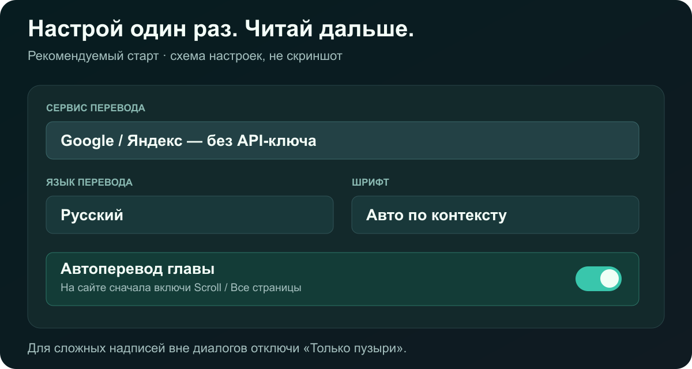

# Настроить за минуту

## 1 · Выбери переводчик

| Режим | Что нужно |
| :--- | :--- |
| **Google / Яндекс** | Ничего вводить не надо. Быстрый старт без ключа; возможны лимиты сервиса |
| **Groq** | Свой ключ Groq. Затем выбери доступную текстовую модель |
| **Свой API** | Совместимый API-адрес, свой ключ и модель из доступного списка |
| **Codex на этом ПК** | Уже настроенный мост Codex и действующая авторизация на ПК. API-ключ OpenAI не нужен. На телефоне этот режим не работает |

Без дополнительных программ работают Google, Яндекс, Groq и API. Мост Codex — отдельная необязательная настройка; его установщик в этом репозитории не распространяется.

## 2 · Язык и оформление

- **Язык интерфейса → Русский** — подписи настроек будут по-русски.
- **Язык перевода → Русский** — язык результата; он задаётся отдельно от интерфейса.
- **Исходный язык → Авто**, **Шрифт → Авто** — начальные настройки. Если распознавание ошибается, укажи исходный язык вручную.
- **Только пузыри** выключи, если нужны также подписи и надписи вне диалогов. Автошрифт подбирает оформление по локальным признакам текста, а не по оценке переводчика.

*Иллюстрация рекомендуемых настроек, не скриншот. Реальные аккаунты, главы и ключи не используются.*

## 3 · Открой главу и включи Авто

Если сайт предлагает **Scroll / Long strip / Все страницы**, включи этот режим. Затем включи **Авто** в Koma: расширение собирает объявленные изображения главы, проверяет язык первых двух страниц, распознаёт текст, переводит и заменяет страницы по мере готовности.

На сайтах с одной видимой страницей или виртуальной читалкой сначала нужно загрузить остальные. Само наличие номера последней страницы ещё не означает, что сайт отдал все картинки.

Для одной картинки — наведи мышь на изображение и нажми дерево. На телефоне используй меню Koma и кнопку перевода. `Alt+Shift+A` — переключить Авто; `Alt+Shift+T` — перевод выделенной области на ПК.

## Полезное

| Функция | Зачем |
| :--- | :--- |
| Контекст | Помогает согласовать соседние реплики; извлечённый текст передаётся провайдеру |
| Свои инструкции | Задать тон, имена и пожелания к переводу |
| История / редактор | Вернуться к результату и поправить оформление |
| Экспорт | Сохранить картинки или главу в доступном формате |
| Диагностика | Локальный журнал ошибок; скачивается вручную из раздела помощи |

Точки у известных моделей Groq — предварительная оценка перевода: **красные выше, белые ниже**. Это не независимый бенчмарк. У неизвестных API-моделей рейтинга нет.

## Если что-то пошло не так

- **Долго при первом старте:** браузер скачивает модели; около 234 МБ, плюс языковые данные OCR. Дай загрузке завершиться.
- **Не видит всю главу:** включи на сайте скролл и дождись появления изображений. Не все сайты объявляют главу целиком.
- **429:** провайдер ограничил запросы; подожди или выбери другой сервис. Параллельность CPU не отменяет API-лимиты.
- **Обрыв / другая ошибка:** перезагрузи вкладку и открой Диагностику. В [issue](https://github.com/Stervakim/Koma-Translate/issues/new) укажи версию, браузер и шаги; не прикладывай API-ключи. Просмотри журнал перед публикацией.

[На главную →](README.md)
