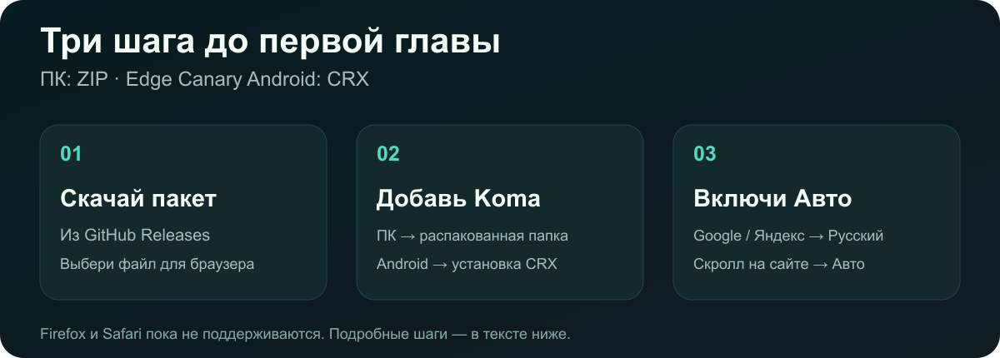

# Установка без лишних действий

## ПК · Chrome / Edge / Brave

1. Открой [релиз 0.3.25](https://github.com/Stervakim/Koma-Translate/releases/tag/v0.3.25), скачай **Koma-Translate-0.3.25-Chromium.zip** и распакуй.
2. Открой `chrome://extensions`, `edge://extensions` или `brave://extensions`. Включи **Режим разработчика**.
3. Нажми **Загрузить распакованное** и выбери извлечённую папку **Koma-Translate**, в которой лежит `manifest.json`. Закрепи значок дерева.

Папку после установки не удаляй. Если браузер или политика организации скрывает загрузку распакованных расширений, этот способ недоступен. На Windows обычный Chrome может блокировать установку CRX не из магазина — используй ZIP и распакованную папку. [Документация Chrome](https://developer.chrome.com/docs/extensions/how-to/distribute).

## Телефон · Edge Canary на Android

1. Скачай **Koma-Translate-0.3.25-Edge-Android.crx** из того же релиза.
2. Открой параметры Edge Canary → **О Microsoft Edge**; если меню разработчика скрыто, несколько раз нажми на номер сборки, пока оно не включится.
3. Вернись в параметры → **Параметры разработчика** → **Extension install by crx** → **Choose .crx file**. Выбери скачанный CRX, подтверди установку.

Названия пунктов могут зависеть от версии Canary. Путь с CRX проверялся на Edge Canary 157. Настройки Koma на телефоне открываются отдельной вкладкой. Обработка изображений выполняется на телефоне; ПК ему не нужен.

## Обновление

- **ПК:** сохрани папку старой версии для отката, замени файлы установленной папки новой распакованной сборкой, нажми ↻ у Koma на странице расширений. Не удаляй само расширение, если хочешь сохранить его данные.
- **Android:** установи новый CRX поверх старого тем же способом. Пакеты подписаны одним ключом. После обновления перезагрузи вкладку главы.
- Фонового обновления из GitHub пока нет. Старые файлы в [Releases](https://github.com/Stervakim/Koma-Translate/releases) предназначены для отката; старые ошибки в них остаются. Браузер может запретить установку более старой версии.

## Firefox и остальные браузеры

Текущий CRX — **не Firefox XPI**. Сборка использует Chromium MV3/offscreen и пока не портирована в Firefox; переименование файла не поможет. Safari, iPhone и обычный Chrome на Android также не поддерживаются. В других браузерах Chromium работоспособность этой сборки отдельно не подтверждена.

[Дальше: настройка →](GUIDE.md) · [На главную →](README.md)
