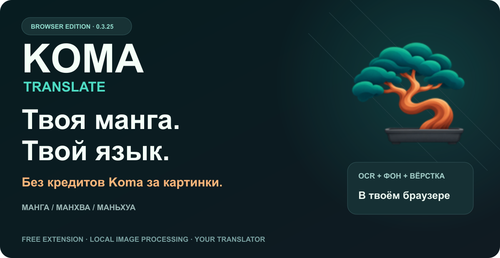
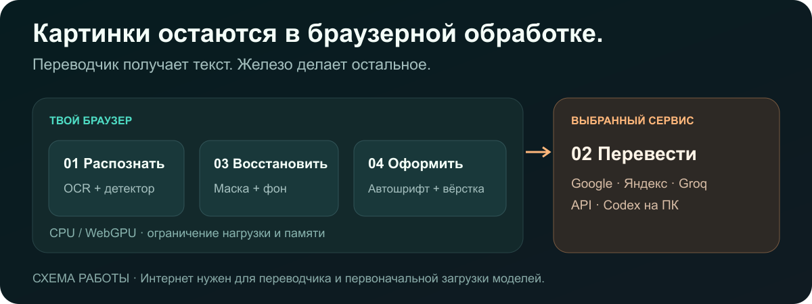

  
  
  

<h1 align="center">Хватит считать картинки. Читай главу.</h1>

<b>Манга, манхва и маньхуа на твоём языке — прямо на странице.</b> Бесплатное расширение. Локальная обработка изображений. Переводчик на твой выбор.

  <a href="https://github.com/Stervakim/Koma-Translate/releases/tag/v0.3.28"><b>⬇ СКАЧАТЬ 0.3.28</b></a> ·
  <a href="INSTALL.md">Установка</a> · <a href="GUIDE.md">Настройка за минуту</a> ·
  <a href="COMPARISON.md">Koma против Torii</a> · <a href="CHANGELOG.md">Что нового</a>

---

## 🌳 Почему Koma

**Torii показал удобный формат. Koma появилась из желания получить его без счётчика платных страниц.** Это независимая реализация, а не официальный форк исходников Torii и не его продукт.

| Тебе нужно | Что даёт Koma |
| :--- | :--- |
| Читать главами | Автоперевод всех найденных страниц; включи режим скролла на сайте |
| Нормальный вид страницы | Поиск текста, удаление букв, восстановление фона и вёрстка внутри браузера |
| Выбирать переводчик | Google / Яндекс без ключей, Groq, свой совместимый API; Codex на настроенном ПК |
| Текст с характером | Автоподбор шрифта, 17 дополнительных гарнитур, поддержка кириллицы |
| Использовать своё железо | WebGPU при поддержке браузера, CPU при несовместимости, общий бюджет задач и памяти |
| Контролировать результат | История, редактор, свой промпт, экспорт PNG / ZIP / PDF / PSD |
| Не оплачивать повторное сканирование | У Koma нет кредитов за обработку изображений |

**Бесплатно — само расширение и его обработка картинок.** Облачный API, подписка Codex и лимиты внешних переводчиков принадлежат их провайдерам. Google/Яндекс без ключей могут ограничивать запросы. Полностью автономный перевод без интернета не обещается.

## ⚡ Начать

1. **ПК:** скачай `Chromium.zip` из [релиза](https://github.com/Stervakim/Koma-Translate/releases/tag/v0.3.28), распакуй, открой страницу расширений → режим разработчика → **Загрузить распакованное** → выбери папку `Koma-Translate`.
2. **Android / Edge Canary:** скачай `Edge-Android.crx`; в параметрах разработчика Edge выбери **Extension install by crx** и укажи файл.
3. В Koma выбери **Google** или **Яндекс**, язык **Русский**, шрифт **Авто**. Открой главу, включи на сайте скролл и в Koma — **Авто**.

[Короткий гайд с картинками →](GUIDE.md) · [Инструкции по браузерам →](INSTALL.md)

> **Совместимость:** сборка MV3 для Chromium. Проверялись Brave на ПК и Edge Canary на Android. Chrome/Edge на ПК — загрузка распакованной папки при наличии этой функции. Firefox, Safari, Chrome на Android и iPhone эта сборка не поддерживает.

## 🥊 Главный соперник — Torii

**Свой ключ, но сканирование всё равно за кредиты? В Koma этой платы нет.** По [тарифам Torii](https://toriitranslate.com/pricing), даже BYOK оставляет плату за сканирование картинки. Koma делает эту работу на устройстве.

У Torii также нужен аккаунт; для Google/Яндекс в Koma — нет. По [политике Torii](https://toriitranslate.com/privacy), сервис получает изображения и URL, а диагностика может включать IP. В Koma картинки обрабатываются в браузере, журнал хранится локально, отдельного сервера Koma для OCR нет. Только извлечённый текст отправляется выбранному переводчику.

Torii уже предлагает больше платформ, веб-пакетную обработку и настольное приложение. Koma пока preview: мы не заявляем победу по точности или скорости без общего теста. **Наше преимущество — отсутствие платы Koma за каждую картинку и контроль над обработкой на своём устройстве.**

[Сравнение с Torii, Ichigo и Immersive Translate →](COMPARISON.md)

## 🧪 Что важно знать

- При первом запуске OCR, детектор и дорисовка загружают примерно **234 МБ моделей** в хранилище браузера, дополнительно к пакету расширения. Японская модель Manga добавляет ещё около **21 МБ**; языковые данные OCR также могут потребовать место. Первый запуск дольше последующих.
- Глава обрабатывается по найденным изображениям. Если сайт показывает одну страницу или виртуализирует читалку, включи скролл либо загрузи следующие страницы. Обход защиты и автоматическое извлечение скрытых страниц не заявлены.
- Сложные рисунки, вертикальная японская надпись и рукописный текст могут давать ошибки. Для сплошного текста вне пузырей отключи «Только пузыри».
- **0.3.28 — preview.** 243 автоматические проверки. Для пяти нейтральных японских примеров проверена цепочка распознавания, Google и вёрстки; отдельные проверки GPU прошли на ПК и телефоне.
- Расширение просит доступ к страницам для замены изображений, к загрузкам для экспорта и native messaging для необязательного режима Codex. [Подробнее о данных →](PRIVACY.md)

## 🚀 Дальше

**Модели и функции будут дорабатываться и обновляться.** В планах — лучшее чтение сложного текста, более аккуратная дорисовка, вёрстка и совместимость с читалками.

**Планируется EXE:** закинул сырой архив манги / манхвы / маньхуа → получил готовую переведённую главу. Цель — результат премиального качества с пакетной обработкой и контролем оформления. Это дорожная карта, а не уже выпущенная функция; срок пока не назначен.

## 📦 Релизы и обратная связь

[Все версии и файлы →](https://github.com/Stervakim/Koma-Translate/releases) · [История изменений →](CHANGELOG.md) · [Сообщить об ошибке →](https://github.com/Stervakim/Koma-Translate/issues/new)

В этом репозитории — оформление, инструкции и готовые сборки. Исходники разработки не публикуются. JavaScript и WASM, необходимые браузеру для работы, входят в установочный пакет; расширение нельзя сделать непросматриваемым архивом.

Сторонние библиотеки, шрифты и модели сохраняют свои лицензии. [Источники и благодарности →](THIRD_PARTY.md)

<b>#KomaTranslate #MangaTranslator #Manhwa #Manhua #BrowserExtension #WebGPU #БезКредитовKoma</b>

